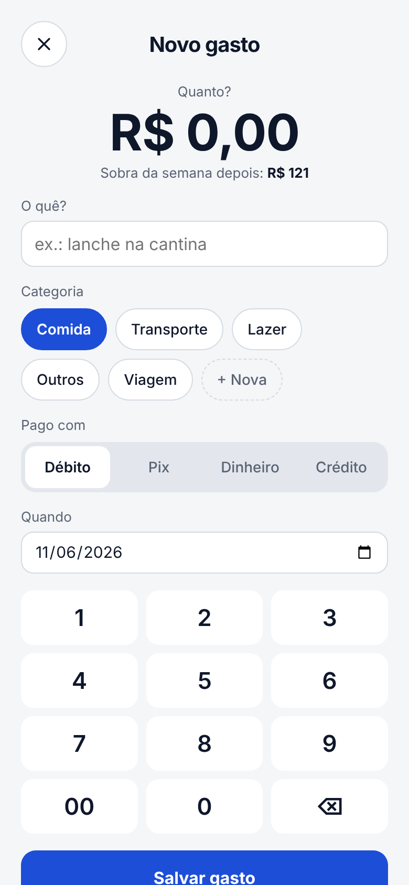
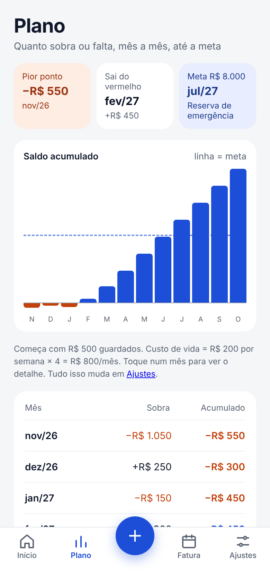

# Gastos — finanças pessoais sem planilha

App web instalável (PWA) para quem vive com o orçamento apertado: registra cada gasto em dois toques, mostra quanto ainda dá para gastar **na semana**, projeta o saldo **mês a mês** até uma meta e simula o **parcelamento da fatura** antes do vencimento.

**Demo:** [gastos-gamma-seven.vercel.app](https://gastos-gamma-seven.vercel.app) — crie uma conta e escolha *Explorar com dados de exemplo*.

<p align="center">
  
  
  
</p>

## O que ele faz

- **Limite semanal por categoria.** Cada gasto entra numa categoria com teto próprio; a tela inicial mostra o que sobra até domingo. Categorias como "viagem" podem ficar fora do limite e funcionar como orçamento total.
- **Plano até a meta.** Junta salário, rendas extras, faturas de cada cartão, parcelas e custo de vida para calcular a sobra de cada mês, o **pior ponto** do saldo, o mês em que ele **volta ao positivo** e quando a **meta** é atingida.
- **Simulador de fatura.** No dia do fechamento, estima o dinheiro disponível (considerando faturas que vencem antes), mostra se falta dinheiro e calcula entrada, parcelas e juros pela tabela Price. Com um toque, o parcelamento escolhido entra no plano.
- **Tudo editável.** Saldo, salário, cartões, faturas mês a mês, compromissos, categorias e meta são configuráveis; o plano recalcula na hora.
- **Feito para celular.** Instala na tela inicial do iPhone/Android, respeita a área segura da tela e usa alvos de toque de 44 px.

## Stack

| Camada | Tecnologia |
| --- | --- |
| Interface | React 19, TypeScript, Vite |
| Dados e login | Supabase (Postgres, Auth, PostgREST) |
| Testes | Vitest |
| Qualidade | oxlint, GitHub Actions (lint + testes + build) |
| Deploy | Vercel |

## Arquitetura

```
src/
  lib/
    plan.ts        # regras de negócio puras: plano mensal, semana, parcela (testadas)
    cards.ts       # próximo fechamento e mês da fatura
    data.ts        # acesso ao Supabase (carregar, inserir, atualizar, apagar)
    seed.ts        # dados de exemplo fictícios e configuração inicial
    format.ts      # moeda e datas em pt-BR
  screens/         # Início, Registrar, Plano, Fatura, Ajustes, Gastos, Login
  components.tsx   # navegação, ícones, campo com salvamento automático
supabase/migrations/  # esquema do banco com RLS
```

Os cálculos ficam em funções puras (`lib/plan.ts`), sem dependência de React ou do banco. Isso facilita testar os cenários e reaproveitar a lógica.

## Segurança

- **Row Level Security em todas as tabelas.** Cada política combina `to authenticated` com `auth.uid() = user_id`, e as políticas de `update` têm `using` e `with check`, então um usuário não consegue ler nem reatribuir dados de outro.
- **Chaves estrangeiras compostas** (`card_id, user_id` e `category_id, user_id`) impedem que uma fatura ou gasto aponte para o cartão ou a categoria de outra pessoa.
- **Só a chave publicável vai para o navegador.** O `vite.config.ts` injeta apenas a URL e a chave publicável do Supabase no build; nenhuma outra variável de ambiente é exposta, e nenhuma chave fica no código ou no repositório.
- O papel `anon` não tem acesso às tabelas.

## Rodando localmente

Pré-requisitos: Node 22+ e um projeto no [Supabase](https://supabase.com).

```bash
git clone https://github.com/Oguipereira/gastos.git
cd gastos
npm install
cp .env.example .env    # preencha com a URL e a chave publicável do seu projeto
npm run dev             # http://localhost:5173
```

Para criar as tabelas, rode `supabase/migrations/20261106000000_schema.sql` no SQL Editor do Supabase (ou `supabase db push` com a CLI).

```bash
npm test        # testes das regras de negócio
npm run lint
npm run build
```

## Deploy na Vercel

1. Importe o repositório na Vercel (o preset Vite é detectado sozinho).
2. Em **Settings → Environment Variables**, cadastre `VITE_SUPABASE_URL` e `VITE_SUPABASE_PUBLISHABLE_KEY` (também aceita `SUPABASE_URL` e `SUPABASE_PUBLISHABLE_KEY`). Só essas duas são injetadas no build pelo `vite.config.ts`.
3. No Supabase, em **Authentication → URL Configuration**, coloque o domínio da Vercel como **Site URL**.

## Como o plano é calculado

Para cada mês do plano:

```
sobra = entradas − faturas dos cartões − compromissos − custo de vida
acumulado = saldo inicial + soma das sobras até o mês
```

O custo de vida é o limite semanal × 4. Parcelas usam a tabela Price: `P · i / (1 − (1 + i)^−n)`.

## Próximos passos

- Importar faturas automaticamente via Open Finance
- Lembretes por push no dia do fechamento
- Modo offline com service worker

## Licença

MIT — veja [LICENSE](LICENSE).
